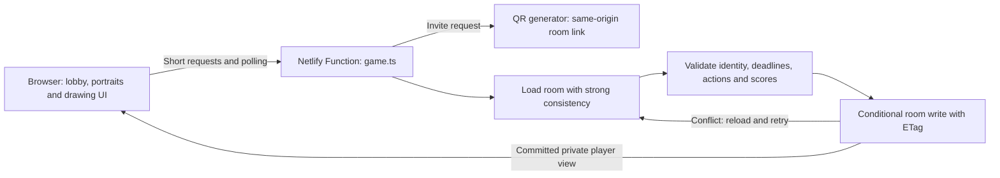

# Retcon — Netlify edition

The existing sketchbook design and gameplay, with a stateless Netlify Function
and site-scoped Netlify Blobs. No GitHub repository, local commands, API keys,
user-configured environment variables, or manual database setup are needed to
publish. Netlify supplies its Blobs connection automatically.

## Publish using your browser

### Automatic updates with GitHub

Connect the source repository to the existing Netlify project under continuous
deployment, using `main` as the production branch. Netlify reads `netlify.toml`:
the build command is `node tools/build.mjs`, the publish directory is `dist`,
and the functions directory is `netlify/functions`. Leave the base directory
at the repository root. The committed lockfile and package-manager version
control dependency installation.

This project's private repository is
https://github.com/Denis-Gamolya/sketchy-alibis and its public game is
https://candid-crisp-9ad27c.netlify.app/. The repository is connected to the
existing Netlify project with automatic production publishing from `main`.

After changes are tested and pushed to `main`, Netlify builds and publishes
them at the existing project URL. Local edits alone do not deploy. No new ZIP
is needed for this workflow. Schedule gameplay or storage changes between
playtests to avoid changing rules during an active game.

Official instructions:
https://docs.netlify.com/build/git-workflows/repo-permissions-linking/

### Manual project upload

1. Extract `netlify-ready-game.zip` into a folder.
2. Sign in to Netlify and use its project-folder upload / drag-and-drop flow.
3. Drop the **complete extracted project folder**, the one containing
   `netlify.toml` and `package.json`. Do not upload only `dist`.
4. Let Netlify install dependencies, run the configured build, and deploy the
   `game` function. Then open the generated HTTPS link.
5. Create a room and share Copy invite with your playtesters.

Use the logged-in source-project build flow. Anonymous static Drop, and output-only
manual uploads, do not build this backend. Netlify's current documentation says
logged-in project uploads can run a build, and instructs ZIP users to extract
first. A ZIP upload alone is not a guarantee that functions will be deployed.
If your dashboard only offers static publishing, use a source-project upload
flow that runs the build; this archive cannot add server execution to a static
upload. No live Netlify deployment is claimed by this package.

Official instructions:
https://docs.netlify.com/deploy/create-deploys/#drag-and-drop

## Play

- 2–8 players, five rounds by default; the host can choose three rounds.
- Draw a personal portrait in the circular lobby editor. Save it manually, or
  let the game apply the current draft automatically when play starts. Portraits
  appear beside player names and remain available for a rematch.
- Click the lobby QR code to copy the invite link, or the room code to copy the
  code. Friends can also scan the QR code to join.
- Game settings offer 30/60/90/120-second drawing time, Familiar words or Full
  library, and all-at-once or host-paced reveals. Only the host can change them,
  and only before the game starts.
- Draw your phrase for 60 seconds. Shuffle has a one-second cooldown.
- The action always stays fixed. During 30 seconds, keep the phrase or change
  the character, object, or both. Underlined parts open searchable family pickers.
  The picker keeps the drawing visible beside the choices on desktop and in a
  separate pane on smaller screens; only the choices scroll in compact mode.
- Vote Truth or Lie on the other drawings during 60 seconds.
- Correct vote: +500. A Truth vote on your drawing: +300, even if you lied.
- Submit/Unsubmit, readiness, host controls, leaving, and shared ties are retained.
- Skipping drawing still allows voting. Empty claims use the original phrase.

## How this edition works



The frontend calls `/.netlify/functions/game` directly. There is no `/api/game`
redirect, custom function path, SSE connection, or continuously running deployed
server. All helpers stay outside `netlify/functions`; `game.ts` is its only file.
Polling also provides presence heartbeats. Deadlines are stored and reconciled
on requests, so no background interval needs to remain alive. Inactive rooms
logically expire after six hours; expired records currently remain in Blobs
storage and may count toward its storage allowance.

Each room is a single aggregate including scores and a bounded request-receipt
list. Strong reads obtain its value and ETag together. Creation uses `onlyIfNew`;
updates use `onlyIfMatch`. Conflicts retry from a new read, and a missing ETag
fails closed. Private prompts, tokens, and other players' drafts never appear
in public views. Do not grant browsers direct access to the room store.

This follows the explicitly requested single-blob conditional-write design.
Netlify recommends a transactional database for transactional data; Blobs does
not provide multi-key transactions. Cross-room transactions are not used here.
For production expansion, revisit storage architecture rather than assuming
this is a general database replacement.
https://www.netlify.com/knowledge-base/how-to-store-files-and-objects-with-netlify-blobs/

## Library and artwork

`game/vocabulary.mjs` contains 202 characters in 38 visual families, 34 actions
in 6 families, and 343 objects in 63 families. Familiar mode offers 112
characters and 171 objects, keeping complete visual
families. Existing IDs remain stable. The generator avoids the last 16 character
and object terms, and avoids exact repeated phrases within a game. All artwork,
custom font assets, and their original source sheets are included.
See `LETTERING.md` for the artwork conventions and optional rebuild workflow.

## Verification and package contents

The automated suite exercises a complete three-round, two-player game with
scoring and a final winner; concurrent submissions; retry receipts; expired
deadlines; private views; and unchanged game rules. A separate test extracts
Netlify's actual packaged function and completes its default five-round game
using the real Blobs SDK against the local emulator. The emulator's missing
GET ETag is bridged in development only, and emulator calls are serialized;
concurrency is tested separately against an atomic conditional-write model.
A hosted build, public access, room creation, joining, and game start were
verified separately. See `VERIFICATION.md` for the scope of those checks.

- `netlify.toml`, `package.json`, `pnpm-lock.yaml`, `pnpm-workspace.yaml`:
  reproducible configuration and dependency installation.
- `web/`: complete frontend source; `dist/`: built browser assets only.
- `netlify/functions/game.ts`: the single deployed function.
- `game/`: rules, vocabulary, persistence and HTTP handling.
- `tests/`: regression and integration tests.
- `verification/game.zip`: portable prepackaged function for inspection.
- `tools/`: build, packaging, and local development helpers.
- `assets/`: original lettering and artwork sources.

The display fonts include Denis's original alphabet, digits, and punctuation.
`assets/lettering/sources.json` maps each PNG sheet to characters; explicit bounds
keep multipart symbols together and place smaller punctuation on the baseline.
With the pinned dependencies in `tools/lettering-requirements.txt`, run
`python tools/build-lettering.py` to regenerate both WOFF2 fonts and their glyph
manifest. Ordinary game builds use the compiled fonts and do not require Python.

The prepackaged function is evidence of the verified build, not a workaround
for static Drop. The logged-in source build packages the function on Netlify.
Free-tier usage limits apply to hosting and Blobs. No hosted accounts or player
accounts are created by this archive.

## Group playtest

Run with 4–6 real people, ideally mixing phones and computers. Try one short game
with Familiar words and host-paced reveals, then a game using the full library.
Observe without coaching the first round. Note:

| Check | Record |
| --- | --- |
| Join and setup | Who needed help joining or saving a portrait? |
| Prompt quality | Repeated terms, frequent shuffles, unfamiliar choices. |
| Round flow | Skipped drawings, missed submissions, confusing reveals. |
| Bluffing | Whether Truth or Lie becomes too predictable, and why. |
| Devices | Any clipping, lost gestures, or keyboard/rotation issues. |

Discuss scoring only after the games. Record the group’s examples before
changing point values. Automated four-player tests verify rules; they do not
replace observing a real group’s fun, understanding, and pacing.

QR generation uses `qrcode-generator` locally on the function, following its
maintainer’s JavaScript API: https://github.com/kazuhikoarase/qrcode-generator/tree/master/js
No third-party QR service receives room invitations.

## Optional developer workflow

These commands are for development and are not required for browser publishing:

```sh
pnpm install --frozen-lockfile
pnpm build
pnpm test
pnpm start
pnpm package
```

Node 22.12 or newer is required. `server.mjs` is a local-only preview adapter;
it is not deployed. Local state lives in ignored `.netlify/blobs`. Production
state lives in the site's Blobs store. The build prebundles the function before
using Netlify's official packager, avoiding machine-specific package symlinks.
